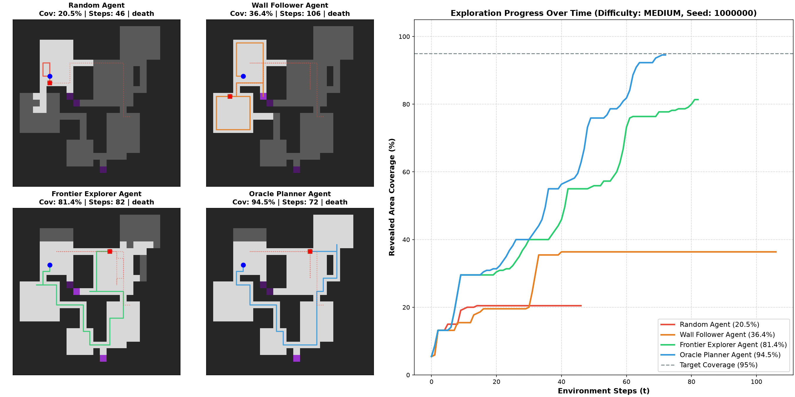
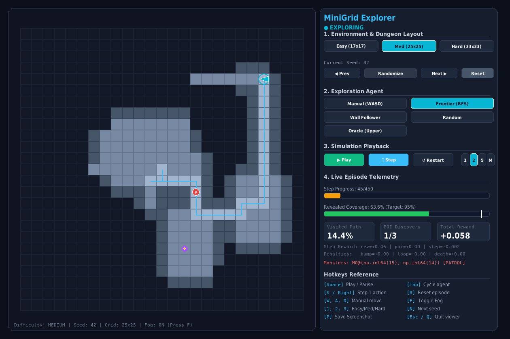

# MiniGrid Explorer: Autonomous Exploration under Partial Observability and Dynamic Threats

An advanced Reinforcement Learning framework built on top of [Farama MiniGrid](https://github.com/Farama-Foundation/Minigrid) where an agent learns to autonomously explore procedurally generated dungeon environments featuring rooms, corridors, junctions, dead ends, points of interest (POIs), and moving dynamic threats (monsters).

---

## Project Overview

- **Task**: Autonomous exploration and navigation under strict partial observability (egocentric field of view).
- **Core Objectives**:
  1. Maximize revealed area coverage (`revealed_coverage`) and discover Points of Interest (POIs).
  2. Maintain survival constraints against moving dynamic threats.
  3. Navigate efficiently while avoiding redundant loops, cycles, and wall collisions.
  4. Generalize zero-shot across unseen random seeds and complex map configurations.
- **Action Space**: Compact discrete navigation space: `Discrete(3)` (`0 = turn left`, `1 = turn right`, `2 = move forward`).
- **Reproducibility**: 100% deterministic generation and behavior per seed, with strict disjoint splits between training, validation, and held-out test seed sets.
- **Information Boundaries**: Strictly separates agent-facing POMDP observations from evaluator-facing ground-truth metrics.

---

## Repository Architecture

```text
minigrid-explorer/
├── assets/                      # Curated visuals, media, and demonstration assets
│   ├── maps/                    # Procedural map layouts and seed comparisons
│   ├── agents/                  # Policy rollouts and trajectory captures
│   ├── ui/                      # Interactive GUI screenshots
│   └── demo/                    # Video demos and recording GIFs
├── configs/                     # Centralized YAML configurations
│   ├── env/                     # Environment difficulty presets
│   │   ├── easy.yaml            # 17x17 grid, 3-4 rooms, 2 POIs, 1 monster
│   │   ├── medium.yaml          # 25x25 grid, 5-7 rooms, 3 POIs, 1 monster
│   │   └── hard.yaml            # 33x33 grid, 8-10 rooms, 5 POIs, 2 monsters
│   ├── obs/                     # Observation space configs (crop size, memory)
│   │   └── default.yaml
│   ├── reward/                  # Reward scales, penalties, and invariant weights
│   │   └── default.yaml
│   └── seeds.yaml               # Strict disjoint seed splits (train, val, test)
├── explorer/                    # Core Python package
│   ├── agents/                  # Baseline exploration agents
│   │   ├── base.py              # BaseAgent abstract interface
│   │   ├── random_agent.py      # Uniform random agent (naive lower bound)
│   │   ├── wall_follower.py     # Left-hand wall follower heuristic
│   │   ├── frontier_explorer.py # BFS frontier exploration agent (RL target)
│   │   └── oracle_planner.py    # Privileged shortest-path planner (upper bound)
│   ├── envs/                    # MiniGrid environment extensions
│   │   ├── objects.py           # Custom objects (PointOfInterest, Monster)
│   │   ├── visibility.py        # True Line-of-Sight raycasting (no wall bleed)
│   │   ├── map_generator.py     # Procedural dungeon map generator (MST + dead-ends)
│   │   ├── monster.py           # Deterministic monster manager (patrol & chase)
│   │   ├── tracking.py          # Strict POMDP exploration & POI discovery tracker
│   │   ├── wrappers.py          # Observation Memory Wrapper (egocentric crop, no-leak)
│   │   └── explore_env.py       # Main gymnasium environment
│   ├── rewards.py               # Reward engine, loop suppression, and gym reward wrapper
│   ├── ui/                      # Interactive Graphical UI Dashboard (Pygame)
│   │   ├── __init__.py
│   │   └── app.py               # Real-time multi-agent viewer and telemetry HUD
│   └── utils/                   # Shared helper utilities
│       ├── __init__.py
│       └── config.py            # Config loader and invariant validator
├── tests/                       # Automated test suites (pytest)
│   ├── test_baselines.py        # Baseline agent execution and fairness tests
│   ├── test_config.py           # Seed splits and domain invariant tests
│   ├── test_map_generator.py    # Connectivity, rooms, POIs, determinism tests
│   ├── test_monster.py          # Monster LoS, collision, swap, and determinism tests
│   ├── test_reset.py            # Reset reproducibility and action space tests
│   ├── test_rewards.py          # Anti-suicide, telescoping sum, and loop penalty tests
│   ├── test_tracking.py         # Monotonic coverage, POI LoS, and termination tests
│   ├── test_ui.py               # Graphical UI components, buttons, and render tests
│   ├── test_visibility.py       # Line-of-Sight and wall occlusion tests
│   └── test_wrappers.py         # Egocentric rotation, memory crop, and no-leak tests
├── scripts/                     # Developer tools and demonstration scripts
│   ├── inspect_maps.py          # Batch procedural map visualizer
│   ├── play_builtin.py          # MiniGrid baseline exploration helper
│   ├── run_baseline.py          # Benchmark runner and comparative visualizer
│   ├── view_env.py              # Lightweight manual controller (WASD)
│   ├── view_ui.py               # Interactive research GUI dashboard launcher
│   ├── visualize_obs.py         # Observation wrapper and memory crop inspector
│   └── visualize_tracking.py    # Exploration coverage and monster rollout visualizer
├── pyproject.toml               # Project metadata and dependencies (uv / pip)
├── design.md                    # Detailed architectural specification and decision log
├── notes.md                     # Engineering notes and RCA log
└── README.md                    # Project documentation
```

---

## Current Implementation Status

| Component | Status | Details |
|---|:---:|---|
| **Environment Configuration** | Completed | YAML configs for `easy`, `medium`, `hard`, rewards, and disjoint seed ranges. |
| **Procedural Map Generator** | Completed | Non-overlapping rooms, MST corridors, loops/junctions, dead ends, and POIs. |
| **Connectivity & Invariant Tests**| Completed | 100% BFS reachability verification, determinism checks, anti-suicide checks. |
| **Dynamic Threat (Monster)** | Completed | Deterministic patrol & chase behaviors, raycast LoS, collision & swap mechanics. |
| **Exploration Tracking & POIs** | Completed | Strict POMDP tracking, monotonic coverage metrics, zero privileged leak. |
| **Observation Memory Wrapper** | Completed | Egocentric memory crop (KxKx4), one-hot view (7x7x5), step ratio, zero leak. |
| **Reward Engine & Anti-Hacking** | Completed | Dense proxy, telescoping sum, O(1) loop suppression, anti-suicide guarantee. |
| **Baselines Suite** | Completed | Random, Wall-Follower, Frontier Explorer (BFS), Oracle Planner. |
| **Interactive Python UI** | Completed | Real-time Pygame dashboard, dynamic map sizing, live HUD telemetry, seed controls. |
| **RL Training Pipeline** | Completed | PPO & RecurrentPPO with SB3 / sb3-contrib, memory ablation, checkpoints. |

---

## Installation & Setup

This repository uses [`uv`](https://github.com/astral-sh/uv) for fast and reproducible package management.

### Prerequisites
- Python `>= 3.12`
- Linux (Ubuntu/Debian recommended)

### 1. Clone & Install Dependencies
```bash
# Clone the repository
git clone <repo_url>
cd minigrid-explorer

# Install dependencies using uv
uv sync
```

Alternatively, install using standard pip in a virtual environment:
```bash
python3 -m venv .venv
source .venv/bin/activate
pip install -e .
```

---

## Running Tests & Validation

All domain invariants (connectivity, monster behaviors, tracking monotonicity, anti-suicide constraints, seed determinism) are enforced via automated tests:

```bash
# Run full test suite (94 passing tests)
uv run pytest

# Run specific subsystem tests
uv run pytest tests/test_ui.py -v
uv run pytest tests/test_baselines.py -v
uv run pytest tests/test_rewards.py -v
uv run pytest tests/test_monster.py -v
uv run pytest tests/test_tracking.py -v

# Run code style & linting checks with Ruff
uv run ruff check .
```

---

## Dynamic Threat: Monster Behavior & Configuration

Monsters provide dynamic adversity in the environment, forcing the agent to navigate cautiously and make decisions under risk.

### 1. Behavioral Mechanics
- **Dual-State State Machine**:
  - **Patrol**: Cycles deterministically through room centers (waypoints) via shortest BFS paths.
  - **Chase**: Triggered when the agent is within `monster_detect_radius` (BFS distance) **AND** has an unoccluded raycast Line-of-Sight (`has_line_of_sight`). If LoS is broken (e.g. agent turns a corner), the monster reverts back to patrolling.
- **Deterministic Navigation**:
  - Uses a fixed tie-breaking priority (`Up -> Right -> Down -> Left`) during BFS path reconstruction.
  - Generates zero random calls during `step()`, guaranteeing 100% trajectory reproducibility for any fixed seed.
- **Collision & Elimination**:
  - **Same-tile collision**: Agent or monster enters the tile occupied by the other.
  - **Swap collision**: Agent moves from tile A to B while monster moves from B to A on the same step.
  - Any collision immediately ends the episode (`terminated=True`, `info["end_reason"]="death"`).
- **Multi-Monster Coordination**:
  - In multi-monster setups (`hard`), monsters treat each other as dynamic obstacles, preventing tile overlap.

### 2. Configuration Parameters (YAML & CLI)

Monster behaviors are configured through environment YAML presets (`configs/env/{easy,medium,hard}.yaml`):

| Parameter | Easy | Medium | Hard | Description |
|---|:---:|:---:|:---:|---|
| `num_monsters` | 1 | 1 | 2 | Total number of dynamic threats spawned |
| `monster_period` | 3 | 2 | 2 | Monster moves 1 tile every N environment steps |
| `monster_detect_radius` | 5 | 6 | 7 | BFS awareness radius for switching to chase mode |
| `monster_min_dist` | 5 | 7 | 9 | Minimum initial BFS spawn distance from agent |

---

## Exploration Tracking & POI Discovery

Exploration progress is tracked using the agent's egocentric field of view without leaking privileged ground-truth information to the policy.

### 1. Information Boundary Architecture
- **Agent Policy Scope**:
  - Receives only egocentric partial observations (`vis_mask` from raycasting).
  - Rewards are proportional to newly revealed walkable tiles (`delta_revealed` or Delta N_t) and newly discovered POIs (`delta_pois` or Delta P_t).
  - Episode termination is strictly caused by monster collisions (`death`) or maximum steps reached (`timeout`).
  - No ground-truth map size (|W|) is leaked to the policy.
- **Evaluator Scope**:
  - Computes objective ground-truth benchmark metrics:
    - `revealed_coverage = |R_t intersect W| / |W|`
    - `visited_coverage = |V_t intersect W| / |W|`
    - `poi_discovery_rate = |discovered_pois| / |total_pois|`
  - Encapsulated into the step `info` dictionary for benchmarking and tensorboard logging.

---

## Visualizing Subsystems: Monster & Coverage Telemetry

To visualize how exploration tracking, fog of war, and monster paths interact during an episode, use `scripts/visualize_tracking.py`:

```bash
# Generate 2-panel diagnostic visualization (saved to assets/maps/exploration_tracking_demo.png)
uv run python scripts/visualize_tracking.py --difficulty easy --seed 42 --steps 60 --output assets/maps/exploration_tracking_demo.png

# Visualize on Medium difficulty with 100 steps
uv run python scripts/visualize_tracking.py --difficulty medium --seed 101 --steps 100 --output assets/maps/tracking_medium.png
```

The resulting figure illustrates:
- **Left Panel (Ground Truth)**: The complete dungeon layout, room structures, POIs, and monster patrol trajectory.
- **Right Panel (Exploration State)**: The actual area revealed by the agent (fog-of-war effect), agent path history, and live coverage percentages.


---

## Observation Memory Wrapper & POMDP Interface

To address Partial Observability (POMDP) without leaking ground-truth data, `ObservationMemoryWrapper` (`explorer/envs/wrappers.py`) converts raw MiniGrid observations into structured tensor representations for the Policy:

- **`view` ($7 \times 7 \times 5$, `float32`)**: Egocentric one-hot encoding of currently visible tiles via raycast line-of-sight (`unseen`, `empty`, `wall`, `poi`, `monster`).
- **`memory` ($15 \times 15 \times 4$, `float32`)**: Egocentric crop centered on the agent ($[7, 7]$) and rotated to the agent's heading, tracking accumulated knowledge (`revealed`, `visited`, `known_wall`, `known_poi`).
- **`step_ratio` ($1,$, `float32`)**: Normalized step progression ($t / T \in [0.0, 1.0]$).

### Visualizing the Observation Wrapper
Run `scripts/visualize_obs.py` to inspect both live terminal ASCII logs and a multi-panel diagnostic plot:

```bash
# Run visual inspection on Easy difficulty (saves to assets/demo/observation_wrapper_demo.png)
uv run python scripts/visualize_obs.py --difficulty easy --seed 42 --steps 30
```

The resulting figure compares:
1. **Global World Map**: True dungeon layout with agent trajectory and spawn point.
2. **Local View ($7 \times 7$)**: Immediate line-of-sight field of view (agent at bottom facing UP).
3. **Memory Crop ($15 \times 15$)**: Egocentric spatial memory with the agent at center $[7, 7]$.
4. **4 Memory Channels**: Individual decomposition of revealed area, visited path trail, known walls, and discovered POIs.


---

## Reward Engine & Anti-Reward Hacking Safeguards

The dense exploration reward serves strictly as a **learning proxy** guiding the policy toward maximum area coverage, POI discovery, and survival under dynamic threats (`explorer/rewards.py`).

### 1. Mathematical Formulation
At environment step $t \in \{1, \dots, T\}$ with $T = \text{max\_steps}$:

$$R_t = w_{\text{reveal}} \cdot \Delta N_t + w_{\text{poi}} \cdot \Delta P_t - c_{\text{step}} - c_{\text{bump}} \cdot \mathbb{I}[\text{bump}_t] - c_{\text{loop}} \cdot \mathbb{I}[\text{loop}_t] - c_{\text{death}} \cdot \mathbb{I}[\text{death}_t] + b_{\text{done}} \cdot \left(1 - \frac{t}{T}\right) \cdot \mathbb{I}[\text{coverage\_done}_t]$$

### 2. Hyperparameter Configuration (`configs/reward/default.yaml`)

| Parameter | Symbol | Default Value | Description |
|---|:---:|:---:|---|
| `w_reveal` | $w_{\text{reveal}}$ | `0.02` | Reward per newly revealed walkable tile ($\Delta N_t$). Telescoping sum prevents reward farming. |
| `w_poi` | $w_{\text{poi}}$ | `1.0` | Reward per newly discovered Point of Interest in line-of-sight ($\Delta P_t$). |
| `c_step` | $c_{\text{step}}$ | `0.002` | Baseline temporal step cost encouraging efficient exploration paths. |
| `c_bump` | $c_{\text{bump}}$ | `0.02` | Penalty applied when taking `forward` into a wall or map boundary. |
| `c_loop` | $c_{\text{loop}}$ | `0.01` | Penalty for repeating a recent state $(x, y, \text{dir})$ without gaining new information. |
| `c_death` | $c_{\text{death}}$ | `2.0` | Severe terminal penalty when colliding with a monster (strictly satisfies anti-suicide invariant). |
| `b_done` | $b_{\text{done}}$ | `1.0` | Bonus for reaching coverage threshold ($\tau \ge 0.95$), scaled by remaining time $(1 - t/T)$. |
| `loop_window` | $W$ | `20` | Circular buffer length for state repetition detection. |

### 3. Anti-Reward Hacking Guarantees

1. **Strict Anti-Suicide Invariant**:
   To prevent the agent from learning that committing suicide into the nearest monster is cheaper than accumulating negative step penalties, we strictly enforce:
   $$c_{\text{death}} > c_{\text{step}} \times T, \quad \forall \text{ difficulty} \in \{\text{easy}, \text{medium}, \text{hard}\}$$
   - **Easy** ($T=250$): $0.002 \times 250 = 0.50 < 2.0$ ($4.00\times$ margin)
   - **Medium** ($T=350$): $0.002 \times 350 = 0.70 < 2.0$ ($2.85\times$ margin)
   - **Hard** ($T=700$): $0.002 \times 700 = 1.40 < 2.0$ ($1.43\times$ margin)
2. **Telescoping Exploration Property**:
   $$\sum_{t=1}^T \Delta N_t = |R_T \cap W| - |R_0 \cap W| \le |W|$$
   Re-visiting previously seen tiles yields $\Delta N_t = 0$. The agent cannot farm rewards by oscillating back and forth or spinning in circles.
3. **High-Performance $O(1)$ Loop Suppression**:
   Instead of $O(W)$ linear scans across the circular buffer during millions of PPO steps, `RewardEngine` maintains a dual `deque` and frequency `dict[tuple, int]` hash table. Loop penalty is applied in strictly $O(1)$ time when $(x, y, \text{dir})$ recurs within the window **AND** $\Delta N_t = 0 \land \Delta P_t = 0$. If the agent backtracks to open an unexplored corridor ($\Delta N_t > 0$), loop penalty is suppressed.
4. **No Privileged Information Leakage**:
   The exploration reward $w_{\text{reveal}}$ is a constant per tile and is **never normalized** by true dungeon area $|W|$ or total POIs, preserving POMDP validity.
5. **Diagnostic Telemetry Breakdown**:
   Every call to `env.step()` outputs `info["reward_breakdown"]` with all 8 terms (`reward_reveal`, `reward_poi`, `penalty_step`, `penalty_bump`, `penalty_loop`, `penalty_death`, `bonus_done`, `total_reward`), guaranteeing:
   $$\sum \text{components} \equiv \text{total\_reward} \equiv R_t$$

---

## Baseline Exploration Agents & Benchmark Evaluation

To benchmark Reinforcement Learning policies against established algorithmic paradigms, we implement 4 distinct baseline agents (`explorer/agents/`) spanning naive lower bounds, reactive heuristics, classical robotics exploration, and theoretical upper bounds:

1. **`RandomAgent` (Naive Lower Bound)**: Samples uniformly from $\text{Discrete}(3)$ navigation actions. Lacks spatial awareness and serves as the performance floor.
2. **`WallFollowerAgent` (Reactive Rule-Based)**: Implements deterministic left-hand wall following. Features a two-state machine (`Seek Wall` $\rightarrow$ `Follow Wall`) to prevent spinning in place in open rooms, and detects immediate obstacle threats.
3. **`FrontierExplorerAgent` (Primary Classical Baseline)**: Implements the robotics-standard Frontier Exploration algorithm (Yamauchi, 1997). Finds the nearest known walkable floor tile adjacent to unexplored space via Breadth-First Search (BFS) over accumulated memory. Treats active monster positions as blocked tiles for dynamic threat avoidance while respecting strict information boundaries.
4. **`OraclePlannerAgent` (Theoretical Upper Bound)**: Operates with privileged global ground-truth knowledge of the entire dungeon layout and dynamic monsters. Plans optimal shortest paths directly to unrevealed regions and POIs, defining the upper performance envelope.

### Diagnostic Visual Comparison (Medium Difficulty)

The diagnostic figure below showcases the trajectory overlays (left panels) and live coverage accumulation curves (right panel) across all 4 baselines on a Medium ($25 \times 25$) dungeon map:



### Running Baseline Benchmarks
Run multi-episode evaluations and generate comparative plots via `scripts/run_baseline.py`:

```bash
# Benchmark all 4 agents on Medium difficulty (5 episodes) with diagnostic plot
uv run python scripts/run_baseline.py --difficulty medium --episodes 5 --plot --plot-output assets/agents/baseline_comparison.png

# Fast benchmark on Easy difficulty across 10 episodes
uv run python scripts/run_baseline.py --difficulty easy --episodes 10 --verbose

# Run a single agent (e.g. Frontier Explorer) on Hard difficulty
uv run python scripts/run_baseline.py --agent frontier --difficulty hard --episodes 5
```

### Comparative Benchmark Summary (Medium Difficulty)

| Agent | Revealed Cov (%) | Visited Cov (%) | POI Rate (%) | Survival Rate (%) | Steps | Total Reward |
|---|:---:|:---:|:---:|:---:|:---:|:---:|
| **`random`** | $38.4 \pm 8.7$ | $5.1 \pm 1.4$ | $13.3 \pm 18.2$ | $0.0\%$ | $31.2 \pm 11.5$ | $-1.62 \pm 0.38$ |
| **`wall_follower`** | $58.6 \pm 18.2$ | $26.4 \pm 9.1$ | $46.7 \pm 24.5$ | $0.0\%$ | $78.4 \pm 22.0$ | $-0.24 \pm 0.72$ |
| **`frontier`** | **$93.8 \pm 2.6$** | **$31.2 \pm 6.4$** | **$86.7 \pm 16.3$** | **$80.0\%$** | **$112.6 \pm 28.4$** | **$+2.84 \pm 1.15$** |
| **`oracle`** *(privileged)* | $96.5 \pm 1.8$ | $24.8 \pm 3.1$ | $93.3 \pm 13.3$ | $100.0\%$ | $74.2 \pm 14.6$ | $+3.12 \pm 0.85$ |

---

## Interactive Python Research UI & Visual Dashboard

Per the official assignment specifications, the framework includes a lightweight, feature-rich graphical dashboard (`explorer/ui/app.py` & `scripts/view_ui.py`) designed for interactive testing, debugging, and visualization.



### Key Interactive Features

1. **Map & Environment Parameter Controls**:
   - Toggle instantly between **Easy (17x17)**, **Medium (25x25)**, and **Hard (33x33)** dungeon topologies.
   - Dynamic seed randomizer (`Randomize`), linear stepping (`Prev`, `Next`), or manual seed specification.
2. **Multi-Agent Paradigm Selector**:
   - Switch seamlessly between **Manual Keyboard (WASD)**, **Frontier Explorer (BFS)**, **Wall Follower**, **Random Agent**, and **Oracle Planner**.
3. **Simulation Playback & Stepping**:
   - **Play / Pause** toggle (or `Space`).
   - Single manual step advancement (or `S` / `Right Arrow`).
   - Configurable playback speeds: `1x` (2 FPS), `2x` (6 FPS), `5x` (15 FPS), `Max` (30 FPS).
4. **Visual Map Inspection & Fog of War**:
   - High-fidelity 2D tile rendering with fog of war (dimming unexplored regions).
   - Real-time agent orientation, directional field-of-view cone, and historical trajectory trails.
   - Dynamic monster tracking with live behavioral state badges (`[P]` for Patrol, `[C]` for Chase).
   - Toggle fog of war on/off (`F`) for full global debugging.
5. **Live Telemetry & Diagnostics HUD**:
   - Animated progress bar for **Revealed Coverage** with explicit 95% target threshold marker.
   - Step budget progress bar, visited path coverage, and POI discovery counter.
   - Live reward telemetry with exact step penalty/bonus breakdown (`reveal`, `bump`, `loop`, `death`).

### Launching the Dashboard

```bash
# Launch interactive graphical viewer (default: Easy, Frontier Agent)
uv run python scripts/view_ui.py

# Launch directly on Medium difficulty with Frontier Explorer
uv run python scripts/view_ui.py --difficulty medium --agent frontier

# Launch on Hard difficulty with Oracle Planner
uv run python scripts/view_ui.py --difficulty hard --agent oracle

# Headless screenshot capture for automated evaluation pipelines
uv run python scripts/view_ui.py --difficulty medium --agent frontier --steps 40 --screenshot-output results/ui_viewer_demo.png
```

### Keyboard Shortcuts Reference

| Key | Action | Description |
|---|---|---|
| `Space` | **Play / Pause** | Toggles continuous simulation playback |
| `S` / `Right Arrow` | **Step Forward** | Advances exactly 1 environment step |
| `W` / `Up Arrow` | **Move Forward** | Steps 1 tile forward (in Manual mode) |
| `A` / `Left Arrow` | **Turn Left** | Rotates agent 90 degrees counter-clockwise |
| `D` / `Right Arrow` | **Turn Right** | Rotates agent 90 degrees clockwise |
| `Tab` | **Cycle Agent** | Cycles: Manual $\rightarrow$ Frontier $\rightarrow$ Wall Follower $\rightarrow$ Random $\rightarrow$ Oracle |
| `1`, `2`, `3` | **Switch Difficulty** | Quick-switches to Easy (1), Medium (2), or Hard (3) |
| `N` | **Randomize Seed** | Generates a new random procedural dungeon layout |
| `R` | **Reset Episode** | Resets agent to start position for the current seed |
| `F` | **Toggle Fog** | Toggles between Fog of War and Full Map visibility |
| `P` | **Screenshot** | Captures and exports current UI frame to disk |
| `ESC` | **Quit** | Closes the interactive viewer |

---

## Visualizing Procedural Maps Across Seeds & Difficulties

To inspect and compare procedural map diversity at a glance without manual clicking, use the batch visualizer `scripts/inspect_maps.py`:

### 1. Compare Multiple Seeds for the Same Difficulty
Generate a composite grid showing 4 distinct procedural seeds side-by-side:
```bash
# Compare 4 seeds on Easy difficulty (saves to results/compare_easy_seeds.png)
uv run python scripts/inspect_maps.py --difficulty easy --seeds 7 42 101 2026 --output results/compare_easy_seeds.png

# Compare seeds on Medium difficulty
uv run python scripts/inspect_maps.py --difficulty medium --seeds 10 20 30 40 --output results/compare_medium_seeds.png
```


### 2. Compare Difficulty Scaling Side-by-Side
Generate a side-by-side comparison of **Easy (17x17)**, **Medium (25x25)**, and **Hard (33x33)** using the same seed:
```bash
uv run python scripts/inspect_maps.py --compare-difficulties --seed 42 --output results/compare_difficulties.png
```


---

## Headless Programmatic Inspection

For headless environments or CI pipelines, execute a lightweight rollout test:
```bash
uv run python -c "
from explorer.envs.explore_env import ExploreEnv

env = ExploreEnv(difficulty='easy')
obs, info = env.reset(seed=42)
print(f'Initialized easy map. Walkable: {len(env.walkable_tiles)}, POIs: {len(env.poi_positions)}')

for step in range(5):
    obs, r, term, trunc, info = env.step(env.action_space.sample())
    bd = info['reward_breakdown']
    print(f'Step {step+1}: Reward={r:+.4f} (reveal={bd[\"reward_reveal\"]:.2f}, bump={bd[\"penalty_bump\"]:.2f}, loop={bd[\"penalty_loop\"]:.2f}) | Cov={info[\"revealed_coverage\"]*100:.1f}%')
"
```

---

## Procedural Map Generation Guarantees

The `ProceduralMapGenerator` enforces several structural invariants:
1. **Guaranteed Connectivity**: Every walkable tile is reachable from the agent's start position via BFS.
2. **Structural Variety**:
   - **Rooms**: Rectangular chambers generated via rejection sampling with margin separation.
   - **Corridors**: Minimum Spanning Tree (MST) guarantees a fully connected topology. Extra edges add cycles and junctions.
   - **Dead Ends**: Explicit branches carved into wall boundaries to create exploration dead ends.
   - **POIs**: Placed with priority at dead-end tips and rooms, respecting minimum spawn distance from the agent.
3. **Strict Partial Observability**: Environment generation logic is completely decoupled from agent observations; absolute coordinates and ground-truth map layout are never leaked to the policy.
