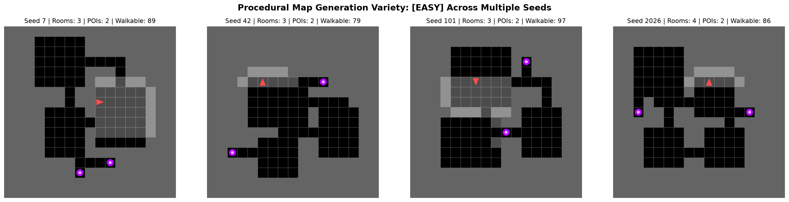
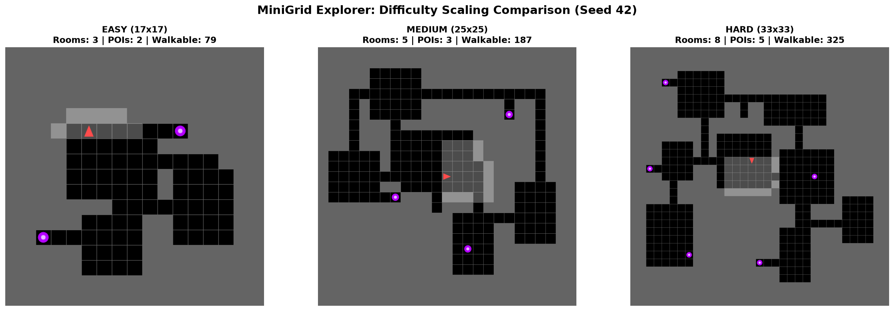

# MiniGrid Explorer: Autonomous Exploration under Partial Observability and Dynamic Threats

An advanced Reinforcement Learning framework built on top of [Farama MiniGrid](https://github.com/Farama-Foundation/Minigrid) where an agent learns to autonomously explore procedurally generated dungeon environments featuring rooms, corridors, junctions, dead ends, points of interest (POIs), and moving dynamic threats (monsters).

---

## Project Overview

- **Task**: Autonomous exploration and navigation under strict partial observability (egocentric field of view).
- **Core Objectives**:
  1. Maximize revealed area coverage (`revealed_coverage`) and discover Points of Interest (POIs).
  2. Maintain survival constraints against moving dynamic threats.
  3. Navigate efficiently while avoiding redundant loops, cycles, and wall collisions.
  4. Generalize zero-shot across unseen random seeds and complex map configurations.
- **Action Space**: Compact discrete navigation space: `Discrete(3)` (`0 = turn left`, `1 = turn right`, `2 = move forward`).
- **Reproducibility**: 100% deterministic generation and behavior per seed, with strict disjoint splits between training, validation, and held-out test seed sets.

---

## Repository Architecture

```text
minigrid-explorer/
├── assets/                      # Curated visuals, media, and demonstration assets
│   ├── maps/                    # Procedural map layouts and seed comparisons
│   ├── agents/                  # Policy rollouts and trajectory captures
│   ├── ui/                      # Interactive GUI screenshots
│   └── demo/                    # Video demos and recording GIFs
├── configs/                     # Centralized YAML configurations
│   ├── env/                     # Environment difficulty presets
│   │   ├── easy.yaml            # 17x17 grid, 3-4 rooms, 2 POIs, 1 monster
│   │   ├── medium.yaml          # 25x25 grid, 5-7 rooms, 3 POIs, 1 monster
│   │   └── hard.yaml            # 33x33 grid, 8-10 rooms, 5 POIs, 2 monsters
│   ├── obs/                     # Observation space configs (crop size, memory)
│   │   └── default.yaml
│   ├── reward/                  # Reward scales, penalties, and invariant weights
│   │   └── default.yaml
│   └── seeds.yaml               # Strict disjoint seed splits (train, val, test)
├── explorer/                    # Core Python package
│   ├── envs/                    # MiniGrid environment extensions
│   │   ├── objects.py           # Custom objects (PointOfInterest, Monster)
│   │   ├── visibility.py        # True Line-of-Sight raycasting (no wall bleed)
│   │   ├── map_generator.py     # Procedural dungeon map generator (MST + dead-ends)
│   │   └── explore_env.py       # Main gymnasium environment
│   └── utils/                   # Shared helper utilities
│       ├── __init__.py
│       └── config.py            # Config loader and invariant validator
├── tests/                       # Automated test suites (pytest)
│   ├── test_config.py           # Seed splits and domain invariant tests
│   ├── test_map_generator.py    # Connectivity, rooms, POIs, determinism tests
│   ├── test_reset.py            # Reset reproducibility and action space tests
│   └── test_visibility.py       # Line-of-Sight and wall occlusion tests
├── scripts/                     # Developer tools and demonstration scripts
│   ├── inspect_maps.py          # Batch procedural map visualizer
│   ├── play_builtin.py          # MiniGrid baseline exploration helper
│   └── view_env.py              # Interactive manual controller (ManualControl)
├── pyproject.toml               # Project metadata and dependencies (uv / pip)
├── design.md                    # Detailed architectural specification & decision log
├── notes.md                     # Engineering notes and RCA log
└── README.md                    # Project documentation
```

---

## Current Implementation Status

| Component | Status | Details |
|---|:---:|---|
| **Environment Configuration** | ✅ Completed | YAML configs for `easy`, `medium`, `hard`, rewards, and disjoint seed ranges. |
| **Procedural Map Generator** | ✅ Completed | Non-overlapping rooms, MST corridors, loops/junctions, dead ends, and POIs. |
| **Connectivity & Invariant Tests**| ✅ Completed | 100% BFS reachability verification, determinism checks, anti-suicide checks. |
| **Dynamic Threat (Monster)** | 🔄 In Progress | Deterministic patrol & chase behaviors, collision mechanics. |
| **Observation Memory Wrapper** | ⏳ Scheduled | Egocentric memory crop, vis_mask filtering (no privileged leak). |
| **Reward Engine & Loop Detection** | ⏳ Scheduled | Telescoping coverage reward, state-repetition penalty. |
| **Baselines Suite** | ⏳ Scheduled | Random, Wall-Follower, Frontier Explorer, Oracle. |
| **RL Training Pipeline** | ⏳ Scheduled | PPO & RecurrentPPO with SB3 / sb3-contrib. |
| **Interactive Python UI** | ⏳ Scheduled | Pygame / pygame-gui real-time inspector and evaluation GUI. |

---

## Installation & Setup

This repository uses [`uv`](https://github.com/astral-sh/uv) for fast and reproducible package management.

### Prerequisites
- Python `>= 3.12`
- Linux (Ubuntu/Debian recommended)

### 1. Clone & Install Dependencies
```bash
# Clone the repository
git clone <repo_url>
cd minigrid-explorer

# Install dependencies using uv
uv sync
```

Alternatively, install using standard pip in a virtual environment:
```bash
python3 -m venv .venv
source .venv/bin/activate
pip install -e .
```

---

## Running Tests & Validation

All domain invariants (connectivity, anti-suicide constraints, seed determinism) are enforced via automated tests:

```bash
# Run full test suite
uv run pytest

# Run linting check with Ruff
uv run ruff check .
```

---

## 🎮 Interactive Exploration & Manual Play

Rather than relying solely on automated unit tests, you can directly launch an interactive Pygame window to inspect maps, navigate manually, and test environment dynamics in real time.

```bash
# Launch interactive manual play (default: Easy, Seed 42)
uv run python scripts/view_env.py

# Launch on Medium difficulty with a specific seed
uv run python scripts/view_env.py --difficulty medium --seed 101

# Launch on Hard difficulty
uv run python scripts/view_env.py --difficulty hard --seed 777
```

### Keyboard Controls
`scripts/view_env.py` inherits directly from MiniGrid's official `ManualControl` class:

| Key | Action | Description |
|---|---|---|
| `W` / `Up Arrow` | **Move Forward** | Steps 1 tile forward (bumps into walls without penalty in free play) |
| `A` / `Left Arrow` | **Turn Left** | Rotates agent 90° counter-clockwise |
| `D` / `Right Arrow` | **Turn Right** | Rotates agent 90° clockwise |
| `1` | **Easy Mode** | Switches to 17x17 map (3-4 rooms, 2 POIs) |
| `2` | **Medium Mode** | Switches to 25x25 map (5-7 rooms, 3 POIs) |
| `3` | **Hard Mode** | Switches to 33x33 map (8-10 rooms, 5 POIs) |
| `N` | **Next Seed** | Generates a new random procedural map on the fly |
| `Backspace` | **Reset** | Resets the agent to the starting position for the current seed |
| `ESC` | **Quit** | Closes the interactive window |

---

## 🗺️ Visualizing Procedural Maps Across Seeds & Difficulties

To inspect and compare procedural map diversity at a glance without manual clicking, use the batch visualizer `scripts/inspect_maps.py`:

### 1. Compare Multiple Seeds for the Same Difficulty
Generate a composite grid showing 4 distinct procedural seeds side-by-side:
```bash
# Compare 4 seeds on Easy difficulty (saves to results/compare_easy_seeds.png)
uv run python scripts/inspect_maps.py --difficulty easy --seeds 7 42 101 2026 --output results/compare_easy_seeds.png

# Compare seeds on Medium difficulty
uv run python scripts/inspect_maps.py --difficulty medium --seeds 10 20 30 40 --output results/compare_medium_seeds.png
```



### 2. Compare Difficulty Scaling Side-by-Side
Generate a side-by-side comparison of **Easy (17x17)**, **Medium (25x25)**, and **Hard (33x33)** using the same seed:
```bash
uv run python scripts/inspect_maps.py --compare-difficulties --seed 42 --output results/compare_difficulties.png
```
*(Add the `--show` flag to display the matplotlib figure window directly on screen).*



---

## 🤖 Headless Programmatic Inspection

For headless environments or CI pipelines, execute a lightweight rollout test:
```bash
uv run python -c "
from explorer.envs.explore_env import ExploreEnv

env = ExploreEnv(difficulty='easy')
obs, info = env.reset(seed=42)
print(f'Initialized easy map. Walkable tiles: {len(env.walkable_tiles)}, POIs: {len(env.poi_positions)}')
for _ in range(5):
    obs, r, term, trunc, info = env.step(env.action_space.sample())
print(f'Rollout step successful. Final agent position: {env.agent_pos}')
"
```

---

## 🧭 Procedural Map Generation Guarantees

The `ProceduralMapGenerator` enforces several structural invariants:
1. **Guaranteed Connectivity**: Every walkable tile is reachable from the agent's start position via BFS.
2. **Structural Variety**:
   - **Rooms**: Rectangular chambers generated via rejection sampling with margin separation.
   - **Corridors**: Minimum Spanning Tree (MST) guarantees a fully connected topology. Extra edges add cycles and junctions.
   - **Dead Ends**: Explicit branches carved into wall boundaries to create exploration dead ends.
   - **POIs**: Placed with priority at dead-end tips and rooms, respecting minimum spawn distance from the agent.
3. **Strict Partial Observability**: Environment generation logic is completely decoupled from agent observations; absolute coordinates and ground-truth map layout are never leaked to the policy.

