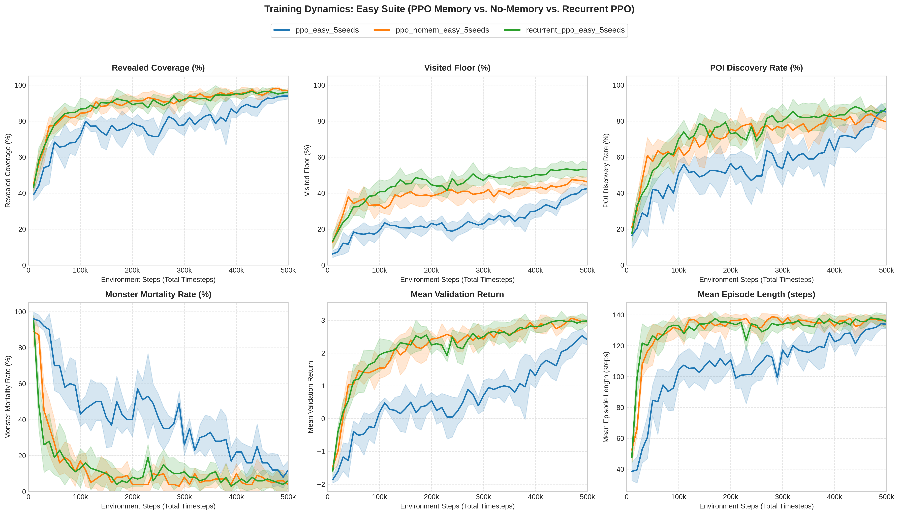
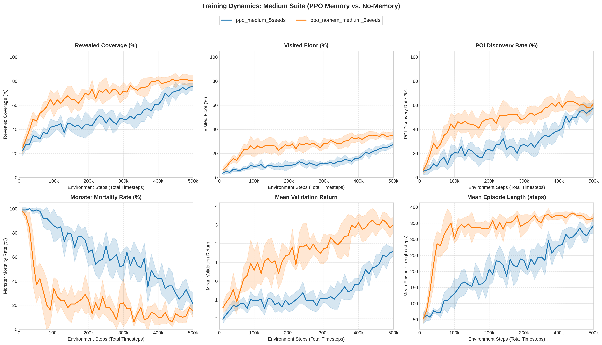
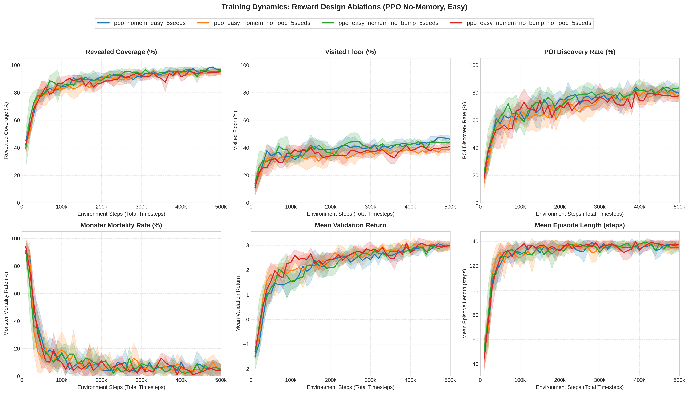

# Benchmark Results & In-Distribution Analysis

## 1. Overview and Benchmark Scope

This section presents the empirical findings across 100 held-out procedural test seeds (`2,000,000` to `2,000,099`), evaluating model families trained across 5 independent seeds alongside non-learning algorithmic and privileged baselines.

The evaluation benchmarks:
1. **Easy Suite ($17 \times 17$, $T=140$):** In-distribution architecture comparisons (PPO Spatial Memory, PPO No-Memory, Recurrent PPO) and reward design ablations.
2. **Medium Suite ($25 \times 25$, $T=390$):** Scaling performance on expanded room topologies with faster dynamic monsters ($\tau=2$).

For each experimental suite, we first analyze the **training dynamics** (convergence speed, stability across 5 random seeds over 500k timesteps), followed by the **held-out test benchmark evaluation** on 100 unseen maps.

---

## 2. Easy Suite Benchmark Results

### 2.1 Training Dynamics (500k Timesteps)
The figure below depicts the learning trajectories across 6 core evaluation metrics, aggregated over 5 independent training runs with $\pm 1\sigma$ standard deviation confidence envelopes:

*Observations on Convergence:*
- **Sample Efficiency:** Both PPO No-Memory and Recurrent PPO exhibit rapid early learning, crossing $80\%$ validation coverage within the first 150k steps. PPO Spatial Memory exhibits a slower initial ascent due to the higher parameter count of its dual-stream CNN encoder.
- **Asymptotic Stability:** By 400k steps, all three architectures reach a stable performance plateau, with Recurrent PPO demonstrating the tightest variance across independent seeds in validation return and mortality.

### 2.2 Held-Out Test Set Evaluation (100 Seeds)
Once converged, model checkpoints (`best_model.zip`) were evaluated across 100 held-out procedural test seeds (`2,000,000` – `2,000,099`) alongside classical and privileged baselines:

| Agent / Model Family | Architecture | Revealed Coverage (%) | Visited Floor (%) | POI Discovery (%) | Success Rate (≥95%) | Death Rate (%) | Steps | Mean Return | Latency (ms) |
| :--- | :---: | :---: | :---: | :---: | :---: | :---: | :---: | :---: | :---: |
| **Baseline: Random** | Heuristic | $40.00\% \pm 10.40\%$ | $7.57\%$ | $20.00\%$ | $0.0\%$ | $100.0\%$ | $34.3$ | $-1.532 \pm 0.629$ | $0.39\text{ ms}$ |
| **Baseline: Frontier BFS** | Deterministic SLAM | $78.10\% \pm 23.43\%$ | $16.65\%$ | $48.50\%$ | $53.0\%$ | $44.0\%$ | $31.8$ | $+1.421 \pm 2.135$ | $0.43\text{ ms}$ |
| **Baseline: Wall Follower** | Heuristic | $50.91\% \pm 20.51\%$ | $24.18\%$ | $39.00\%$ | $7.0\%$ | $77.0\%$ | $65.0$ | $-0.438 \pm 1.507$ | $0.36\text{ ms}$ |
| **Baseline: Oracle Planner (Privileged Baseline)** | Omniscient BFS | $88.34\% \pm 17.09\%$ | $18.81\%$ | $61.00\%$ | $71.0\%$ | $27.0\%$ | $31.2$ | $+2.379 \pm 1.900$ | $0.43\text{ ms}$ |
| **PPO (Spatial Memory)** | Dual-Stream CNN | $88.83\% \pm 1.21\%$ | $24.57\%$ | $59.30\%$ | $74.8\%$ | $11.2\%$ | $61.7$ | $+2.361 \pm 0.122$ | $0.98\text{ ms}$ |
| **PPO (No Memory)** | Single-Stream CNN | **$90.67\% \pm 2.05\%$** | $28.81\%$ | $62.60\%$ | **$77.8\%$** | **$4.6\%$** | $71.5$ | **$+2.609 \pm 0.107$** | **$0.82\text{ ms}$** |
| **RecurrentPPO (LSTM)** | CNN + LSTM | $89.30\% \pm 1.40\%$ | **$34.79\%$** | **$64.60\%$** | $74.2\%$ | $9.2\%$ | $75.1$ | $+2.535 \pm 0.135$ | $1.03\text{ ms}$ |

### 2.3 Computational Trade-offs & Scaling Selection
A key takeaway from the Easy benchmark is that **Recurrent PPO (LSTM)** achieves competitive results ($89.30\%$ coverage, $74.2\%$ success rate) with superior POI discovery ($64.60\%$) and exceptionally low loop rates ($12.92\%$). However, its performance delta compared to feedforward **PPO (No Memory)** ($90.67\%$ coverage, $77.8\%$ success rate) and standard **PPO (Spatial Memory)** ($88.83\%$ coverage) is relatively marginal, while its computational overhead is substantially higher:
- **Training Compute Disparity:** Recurrent PPO requires sequential Backpropagation Through Time (BPTT), demanding **~17.5 minutes per 500k steps**—more than **$2.3\times$ longer** than PPO No-Memory (~7.7 minutes) and ~1.7× longer than PPO Spatial Memory (~10 minutes).
- **Inference Latency & Complexity:** Its per-step latency ($1.03\text{ ms}$) is ~25% slower than PPO No-Memory ($0.82\text{ ms}$), and requires maintaining, passing, and resetting hidden states $(h_t, c_t)$ across rollout workers.

Due to this marginal performance difference combined with the significant compute gap, we decided **not to train Recurrent PPO on the larger Medium maps ($25 \times 25$)**, prioritizing our training compute and multi-seed budgets on the two primary paradigms: **PPO (Spatial Memory)** vs. **PPO (No Memory)**. Nonetheless, the Easy-trained Recurrent PPO checkpoint is retained and evaluated in zero-shot cross-difficulty transfer to benchmark how temporal recurrent representations generalize out-of-distribution to larger mazes and faster adversaries.

---

## 3. Medium Suite Benchmark Results

### 3.1 Training Dynamics (500k Timesteps)
Scaling to Medium maps ($25 \times 25$, 5-7 rooms, 3 POIs, monster movement period $\tau=2$) introduces severe exploration bottlenecks and heightened threat pressure:

*Observations on Convergence:*
- **Exploration Lag in Spatial Memory:** PPO Spatial Memory plateaus around $70\%$ coverage and struggles to minimize mortality ($25\% - 30\%$). In contrast, PPO No-Memory maintains steady upward progression throughout the entire 500k budget, exceeding $80\%$ coverage with consistently declining mortality.

### 3.2 Held-Out Test Set Evaluation (100 Seeds)
Ensemble performance evaluated across the 100 held-out test seeds on Medium difficulty:

| Agent / Model Family | Training Setting | Revealed Coverage (%) | Visited Floor (%) | POI Discovery (%) | Success Rate (≥95%) | Death Rate (%) | Steps | Mean Return | Latency (ms) |
| :--- | :---: | :---: | :---: | :---: | :---: | :---: | :---: | :---: | :---: |
| **Baseline: Random** | Heuristic | $22.22\% \pm 7.46\%$ | $3.89\%$ | $5.67\%$ | $0.0\%$ | $100.0\%$ | $36.5$ | $-1.649 \pm 0.487$ | $0.42\text{ ms}$ |
| **Baseline: Frontier BFS** | Deterministic SLAM | $59.90\% \pm 28.60\%$ | $13.91\%$ | $42.00\%$ | $23.0\%$ | $77.0\%$ | $50.9$ | $+1.695 \pm 2.850$ | $0.47\text{ ms}$ |
| **Baseline: Wall Follower** | Heuristic | $32.90\% \pm 17.19\%$ | $14.70\%$ | $19.33\%$ | $0.0\%$ | $92.0\%$ | $106.1$ | $-0.887 \pm 1.339$ | $0.36\text{ ms}$ |
| **Baseline: Oracle Planner (Privileged Baseline)** | Omniscient BFS | $77.46\% \pm 25.90\%$ | $18.98\%$ | $59.00\%$ | $51.0\%$ | $49.0\%$ | $60.8$ | $+3.703 \pm 3.100$ | $0.46\text{ ms}$ |
| **PPO (Memory, Med-trained)** | In-Distribution | $71.83\% \pm 2.59\%$ | $20.80\%$ | $49.47\%$ | $33.6\%$ | $27.4\%$ | $221.8$ | $+1.573 \pm 0.426$ | $0.97\text{ ms}$ |
| **PPO (No Memory, Med-trained)**| In-Distribution | **$81.79\% \pm 2.21\%$** | **$29.16\%$** | **$58.00\%$** | **$51.0\%$** | **$9.2\%$** | $247.8$ | **$+3.364 \pm 0.523$** | **$0.83\text{ ms}$** |

---

## 4. Key Comparative Insights

### 4.1 Vulnerability of Non-Learning and Heuristic Baselines
All non-learning baselines experience severe degradation in the presence of dynamic adversaries:
- **Random Policy:** Fails catastrophically ($100.0\%$ mortality on both Easy and Medium), wandering aimlessly into walls ($8.85\%$ bump rate) and monster paths.
- **Wall Follower:** Trapped by cyclic topologies and dead ends ($77.0\%$ mortality on Easy, $92.0\%$ on Medium), achieving only $7.0\%$ success on Easy and $0.0\%$ on Medium.
- **Frontier BFS:** While achieving respectable initial frontier exploration on Easy ($78.10\%$ coverage, $53.0\%$ success), its performance collapses on Medium ($59.90\%$ coverage, $77.0\%$ mortality). Because Frontier BFS plans shortest paths strictly toward unrevealed boundary cells without threat perception, it frequently marches directly into pursuing monsters when trapped in narrow corridors.
- **Oracle Planner (Privileged Baseline):** Despite having omniscient topological knowledge of the entire floor plan and all POI coordinates, Oracle suffers $27.0\%$ mortality on Easy and $49.0\%$ on Medium. Omniscient geometric shortest-path routing cannot substitute for active, reactive evasion policies when dynamic threats close in.

Learned RL policies drastically outperform classical and privileged baselines in survival, maintaining low mortality ($4.6\%$ on Easy, $9.2\%$ on Medium) through active threat evasion.

### 4.2 The Reactive Advantage: Why No-Memory Outperforms Spatial Memory
A critical empirical finding of this investigation is that **PPO without explicit spatial memory consistently achieves superior coverage and survival compared to PPO with spatial memory**:
- On Easy maps: PPO No-Memory achieves $90.67\%$ coverage with a $4.6\%$ death rate, whereas PPO Memory achieves $88.83\%$ coverage with an $11.2\%$ death rate.
- On Medium maps: In-distribution PPO No-Memory achieves $81.79\%$ coverage with a $9.2\%$ death rate, compared to $71.83\%$ coverage and a $27.4\%$ death rate for PPO Memory.
- **Underlying Cause:** The explicit $15 \times 15$ spatial memory crop provides topological context, but introduces behavioral inertia. Policies trained with memory crops often commit to re-checking unrevealed border tiles visible within their memory window, making them hesitant to flee when monsters approach. In contrast, the reactive policy (conditioned purely on the immediate $7 \times 7$ field of view and temporal budget) exhibits high evasive agility, executing swift directional shifts upon adversary detection.

### 4.3 Temporal Memory Strengths of Recurrent PPO (LSTM)
Recurrent PPO establishes strong competitive performance across all exploration metrics:
- Achieves **$89.30\% \pm 1.40\%$** revealed coverage and a **$74.2\%$** success rate, operating strictly on the immediate $7 \times 7$ field of view without any explicit 2D spatial memory grid.
- **Superior POI Acquisition and Floor Traversal:** Recurrent PPO achieves the highest POI discovery rate (**$64.60\%$**) and highest visited floor coverage (**$34.79\%$**) across all evaluated architectures, outperforming both feedforward PPO variants and the privileged Oracle baseline ($61.00\%$).
- **Suppression of Corridor Oscillation:** The recurrent hidden states $(h_t, c_t)$ retain short-term temporal trajectory history, reducing the loop rate to just **$12.92\%$** (compared to $22.92\%$ for PPO No-Memory and $33.42\%$ for PPO Spatial Memory). The agent rarely reverses direction pointlessly in symmetric hallways.
- **Trade-off:** The recurrent recurrence introduces slightly higher per-step inference latency ($1.03\text{ ms}$ vs $0.81\text{ ms}$ for feedforward PPO No-Memory) and slower training throughput ($17.53\text{ mins/run}$ vs $7.72\text{ mins/run}$), reflecting the computational overhead of Backpropagation Through Time (BPTT).

---

## 5. Reward Design Ablation Study

### 5.1 Training Dynamics Across Reward Variants
The learning curves below illustrate how individual penalty components shape training progress on the Easy suite:

### 5.2 Held-Out Test Set Evaluation
To evaluate the contribution of individual reward regularizers, we evaluated four ablation variants on the Easy suite (100 test seeds across 5 training runs):

| Reward Variant | Revealed Coverage (%) | Success Rate (≥95%) | Death Rate (%) | Wall Bump Rate (%) | Loop Rate (%) | Mean Steps | Mean Return |
| :--- | :---: | :---: | :---: | :---: | :---: | :---: | :---: |
| **Full Reward (Baseline)** | **$90.67\% \pm 2.05\%$** | **$77.8\%$** | **$4.6\%$** | **$0.00\%$** | **$22.92\%$** | **$71.5$** | **$+2.609 \pm 0.107$** |
| **No Loop Penalty** | $88.78\% \pm 1.75\%$ | $73.8\%$ | $5.6\%$ | $0.51\%$ | **$30.58\%$** | $72.3$ | $+2.386 \pm 0.165$ |
| **No Bump Penalty** | $90.37\% \pm 0.66\%$ | $77.2\%$ | $3.8\%$ | $0.08\%$ | $23.63\%$ | $71.9$ | $+2.598 \pm 0.095$ |
| **No Bump & No Loop** | $90.06\% \pm 1.34\%$ | $75.4\%$ | $4.4\%$ | $0.01\%$ | **$27.79\%$** | $73.5$ | $+2.516 \pm 0.106$ |

### 5.3 Analysis of Regularization Effects:
1. **Loop Penalty Suppresses Behavioral Degeneracy:**
   Removing the loop penalty ($c_{\text{loop}} = 0$) causes the loop rate to surge from $22.92\%$ to $30.58\%$ (a relative increase of $+33.4\%$). Without penalty pressure on revisited poses, the agent wastes exploratory budget pacing back and forth in symmetric corridors, which inflates episode steps ($72.3$ steps) while degrading overall revealed coverage ($88.78\%$).
2. **Wall Bump Regularization Enforces Clean Kinematics:**
   While absolute bump rates remain low, omitting bump penalties allows invalid forward actions along corridor walls ($0.08\%$ vs $0.00\%$), leading to minor navigational hesitation.
3. **Navigational Step Efficiency:**
   The full reward formulation achieves the most efficient exploration trajectory, requiring the lowest average step count (**$71.5$ steps**) to achieve the highest coverage (**$90.67\%$**). In contrast, removing both bump and loop penalties degrades temporal efficiency to **$73.5$ steps**, demonstrating that navigation regularizers streamline trajectories rather than impeding exploration.
4. **Reward Invariance:**
   The full reward formulation maintains the highest overall success rate ($77.8\%$) and highest cumulative return ($+2.609$), verifying that the anti-hacking regularizers guide policy optimization without constraining exploratory reach.
