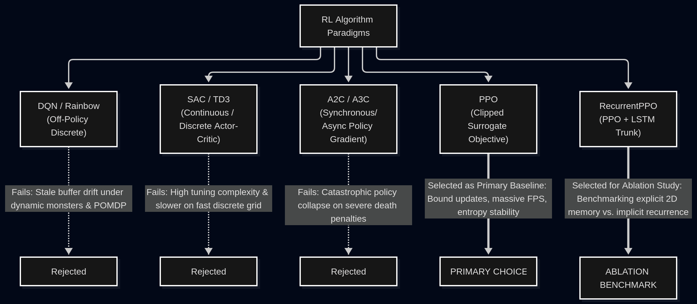
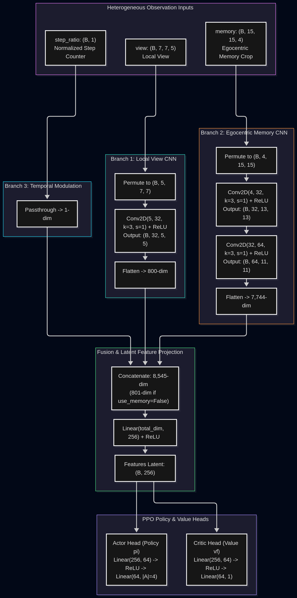

# Algorithm Selection & Policy Architecture Specification

## 1. Executive Summary

This document provides a comprehensive technical justification for the choice of Reinforcement Learning (RL) algorithm and the design of the custom neural network policy architecture for the **MiniGrid Explorer** benchmark.

The exploration task operates in a procedurally generated dungeon environment characterized by:
1. **Strict Partial Observability (POMDP):** The agent only receives an egocentric $7 \times 7$ line-of-sight view and an egocentric $15 \times 15$ spatial memory crop;
2. **Dynamic Threats (Non-Stationary Transitions):** Autonomous roaming monsters actively hunt the agent upon line-of-sight detection;
3. **Severe Penalties and Delayed Rewards:** A high death penalty ($c_{\text{death}} = -2.0$) vs. sparse POI discoveries ($w_{\text{poi}} = +1.0$) and telescoping exploration increments ($\Delta N_t \cdot 0.02$).

---

## 2. Algorithm Selection & Comparative Trade-Off Analysis

### 2.1 Candidate Algorithm Evaluation

We evaluated five prominent reinforcement learning algorithmic paradigms against the unique constraints of this benchmark:

#### 1. Deep Q-Networks (DQN / Rainbow) — Off-Policy Value-Based
- **Mechanism:** Maintains an Experience Replay Buffer $\mathcal{D}$ and optimizes Bellman error via Temporal Difference (TD) updates:
  $$L(\theta) = \mathbb{E}_{(s, a, r, s') \sim \mathcal{D}} \left[ \left( r + \gamma \max_{a'} Q(s', a'; \theta^-) - Q(s, a; \theta) \right)^2 \right]$$
- **Failure Modes in this Environment:**
  - *Deadly Triad & Non-Markovian Stale Buffer:* Under POMDP, observations do not satisfy the Markov property ($P(o_{t+1}|o_t, a_t) \neq P(s_{t+1}|s_t, a_t)$). Historical transitions stored in $\mathcal{D}$ reflect outdated monster paths and partial states. Combining off-policy replay with bootstrapping and function approximation (the Deadly Triad) triggers severe state-aliasing bias and Q-divergence.
  - *Dynamic Threat Distribution Shift:* As the exploration policy evolves, early death transitions where monsters cornered the agent severely distort target Q-values, causing hyper-conservative freezing behavior or erratic value oscillations.
  - *Slow Long-Horizon Credit Assignment & Buffer Overhead:* Exploration episodes span hundreds of steps ($T = 250 - 600$). Standard TD updates propagate rewards backward slowly compared to Generalized Advantage Estimation ($\text{GAE-}\lambda$). Furthermore, storing multi-modal dictionary observations (`view` + `memory`) in a large replay buffer incurs massive RAM consumption and sampling bottlenecks, losing MiniGrid's vectorized execution advantages.

#### 2. Soft Actor-Critic (SAC) — Off-Policy Maximum Entropy
- **Mechanism:** Actor-critic framework maximizing expected return alongside policy entropy:
  $$J(\pi) = \sum_t \mathbb{E}_{(s_t, a_t)} [r(s_t, a_t) + \alpha \mathcal{H}(\pi(\cdot|s_t))]$$
- **Failure Modes in this Environment:**
  - *Discrete Action Space Adaptation:* Standard SAC is formulated for continuous action spaces $\mathcal{A} \subset \mathbb{R}^d$. Adapting SAC to discrete actions requires Discrete SAC (computing expectations over all $|A|$ discrete actions for double Q-critics), which introduces severe gradient variance on low-dimensional grid actions.
  - *Temperature Sensitivity:* Auto-tuning the temperature parameter $\alpha$ in sparse, highly penalized environments frequently causes the entropy term to dominate or collapse, leading to unstable learning curves.

#### 3. Advantage Actor-Critic (A2C / A3C) — On-Policy Policy Gradient
- **Mechanism:** Synchronous on-policy policy gradient without surrogate clipping:
  $$\nabla_\theta J(\theta) = \mathbb{E}_t \left[ \nabla_\theta \log \pi_\theta(a_t|s_t) \hat{A}_t \right]$$
- **Failure Modes in this Environment:**
  - *Catastrophic Policy Collapse on Death Penalty:* When an agent encounters a monster and receives $c_{\text{death}} = -2.0$, the advantage $\hat{A}_t \ll 0$ produces an unbounded negative gradient step. A single batch with multiple collision transitions can catastrophically push action logits into near-zero probabilities, causing irreversible policy collapse.

#### 4. Proximal Policy Optimization (PPO) — **Primary Recommendation**
- **Mechanism:** Clipped surrogate objective constraining policy updates within a trust region:
  $$L^{\text{CLIP}}(\theta) = \hat{\mathbb{E}}_t \left[ \min\left( r_t(\theta) \hat{A}_t, \, \text{clip}(r_t(\theta), 1-\epsilon, 1+\epsilon) \hat{A}_t \right) \right]$$
  where $r_t(\theta) = \frac{\pi_\theta(a_t|s_t)}{\pi_{\theta_{\text{old}}}(a_t|s_t)}$.
- **Key Justifications:**
  1. *Gradient Bounding via Clipping ($\epsilon = 0.2$):* When severe penalties occur ($c_{\text{death}} = -2.0$), the clipped objective strictly prevents destructive parameter updates, preserving exploration stability.
  2. *Ultra-High Vectorized Throughput:* MiniGrid operates as an in-memory NumPy/Python simulator exceeding $20,000$ steps/sec. PPO leverages synchronous parallel workers (`SubprocVecEnv` / `DummyVecEnv` with 8–16 workers) to gather diverse on-policy rollouts rapidly.
  3. *Explicit Entropy Control ($\beta \mathcal{H}(\pi_\theta)$):* Balances frontier expansion vs. monster evasion by preventing premature policy convergence in multi-room layouts.
  4. *Generalized Advantage Estimation (GAE-$\lambda$):* Mitigates credit assignment variance across long exploration trajectories ($T=250 \dots 450$).

#### 5. RecurrentPPO (PPO + LSTM) — **Ablation Benchmark**
- **Mechanism:** Integrates an LSTM recurrent cell between the feature extractor and actor/critic heads to maintain a hidden state $h_t = \text{LSTM}(h_{t-1}, f(o_t))$.
- **Role in Research:**
  - Serves as the direct comparative baseline to assess whether an **explicit spatial memory crop** (`memory` $15 \times 15 \times 4$) outperforms an **implicit recurrent hidden state** (LSTM).
  - Explicit spatial crops provide 2D geometric inductive bias (spatial invariance via 2D convolutions), whereas LSTMs must learn spatial relationships implicitly through sequence unrolling (BPTT), which incurs higher computational cost and slower convergence.

---

### 2.2 Algorithm Comparison Matrix

| Criterion | DQN / Rainbow | SAC (Discrete) | A2C | **PPO (Proposed)** | RecurrentPPO (Ablation) |
|---|:---:|:---:|:---:|:---:|:---:|
| **Sample Paradigm** | Off-policy | Off-policy | On-policy | **On-policy** | On-policy |
| **POMDP Robustness** | Very Low (Buffer staleness) | Low | Medium | **High (with Memory Crop)** | High (Implicit Recurrence) |
| **Stability under Severe Penalties** | Low (Q-divergence) | Low | Poor (Policy collapse) | **Very High (Clipped $\epsilon$)** | Very High (Clipped $\epsilon$) |
| **Throughput (FPS)** | ~1,200 | ~800 | ~18,000 | **~15,000 - 22,000** | ~4,500 - 6,000 |
| **Inductive Bias for Spatial Layout** | None | None | None | **High (2D CNN on Memory)** | Low (Learned sequentially) |
| **Hyperparameter Sensitivity** | High | Very High | Medium | **Low - Moderate** | High (Sequence chunking) |
| **Selection Decision** | Rejected | Rejected | Rejected | **Primary Architecture** | **Ablation Baseline** |

---

## 3. Custom Multi-Modal Policy Architecture

Standard reinforcement learning feature extractors (such as Stable-Baselines3's default `NatureCNN`) cannot be used directly in this environment:
1. **Kernel vs. Dimension Mismatch:** `NatureCNN` uses an $8 \times 8$ kernel (stride 4) designed for Atari $84 \times 84$ frames, which crashes on MiniGrid's $7 \times 7$ field-of-view due to negative output spatial dimensions.
2. **Heterogeneous Observation Modalities:** Our observation space is a `spaces.Dict` combining multi-channel spatial grids (`view` $7 \times 7 \times 5$, `memory` $15 \times 15 \times 4$) and a continuous temporal scalar (`step_ratio` $1 \times 1$). Default SB3 extractors flatten non-standard images into unstructured 1D vectors, destroying 2D spatial locality.

To resolve this, we employ `CustomCombinedExtractor`, a lightweight multi-modal architecture with dedicated pathways for local vision, accumulated spatial memory, and temporal budgeting:

The architecture natively supports ablation benchmarking via `use_memory: bool`: setting it to `False` disables the memory branch, allowing empirical measurement of the explicit spatial memory contribution.

